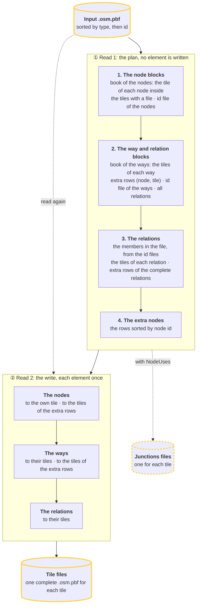
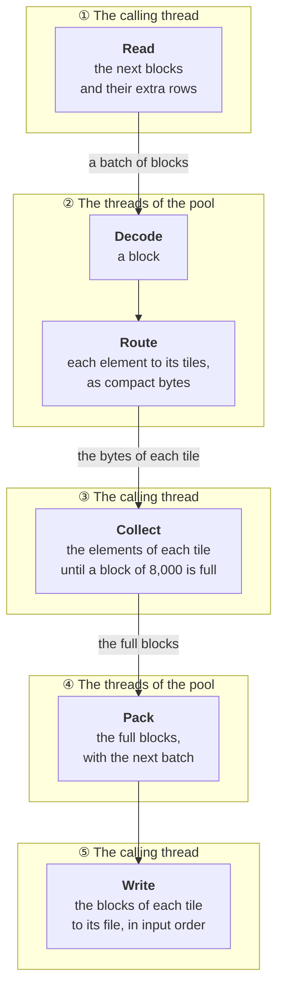

# The rules of the cut

Each tile file of pbfcut is a complete `.osm.pbf` file. These rules give the elements of a tile:

1. Each node inside the boundary goes to exactly one tile: the tile that holds it. A node on the line between two
   tiles goes to the tile east or south of the line.
2. A way with a node in a tile goes to that tile, complete: all its nodes, also the nodes outside the tile.
3. A relation with a member in a tile goes to that tile, with its parent relations.
4. A relation of a type in `--complete` (default: `multipolygon` and `boundary`) goes to every tile with a member,
   with all its members. A member way comes with all its nodes. A program can then make the polygons of the tile
   from the tile file alone.
5. A tile with no node inside has no file.

An H3 cell (`pbfcut h3`) has the same rules, with a cell in place of a tile. A node goes to the cell of its point. A
node exactly on the line between two cells goes to one cell only, as H3 gives it.

These are the rules of osmium's `smart` strategy (`osmium extract -s smart -S types=multipolygon,boundary`), with one
difference. osmium gives a node exactly on a tile border to the two tiles, because its bounding box includes its edge.

## Areas

The cut to a list of areas (`pbfcut areas`) uses the same rules, with "area" in place of "tile". Areas can overlap,
so a node can go to more than one area. A node exactly on the border of an area is inside it. Then the area files
have the same elements as the files of `osmium extract -c` with the smart strategy.

The cut keeps one number for each node. For a node in one area, the number is the area. For a node in more than one
area, the number is a set of areas: the cut keeps a table of the sets that it finds. Thus the memory of the cut does
not grow with the overlap. With `--steps`, the line of step 1 gives the number of sets.

## How the cut works

The cut reads the file two times.

- Read 1 makes the plan. It records the tile of each node as runs of ids (nodes with near ids are usually in one
  place), compressed. Then it finds the tiles of each way, the nodes that each tile needs from outside it, and the
  tiles of each relation. The large lists go to temporary files.
- Read 2 writes each element into the files of its tiles, once, in the order of the input file.

The elements are never all in memory, and the memory does not grow with the number of tiles.

### The data of the two reads

Read 1 decodes each block of the input one time and keeps only lists of ids and tiles. Part 3 finds which members of
the relations the file has in the id files, so it reads no block of the input again.

### The threads of read 2

The calling thread reads the next batch while the pool decodes the batch before. The pool packs the full blocks of
the tiles together with the decoding of a later batch. Only the calling thread opens the files: in the browser, a file
of the storage belongs to the thread that opened it.

Each tile file has full blocks of 8,000 elements. One block of the input gives a tile only some elements (France at
zoom 8: about 77 nodes), so the elements of each tile wait until they fill a block. They wait as compact bytes, one
buffer for each tile and input block, and all of them hold an eighth of the memory budget at most. Above that, the
tiles that hold the most write their blocks before they are full. A small budget thus gives other blocks, but the same
elements.
