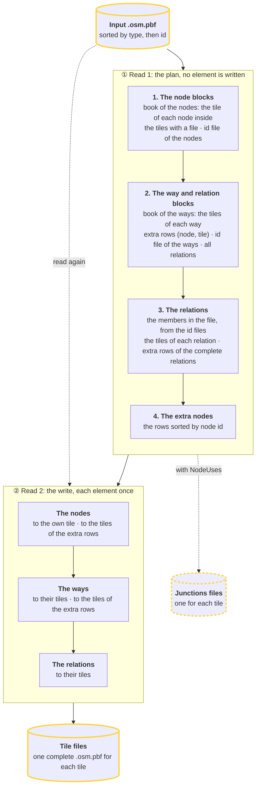
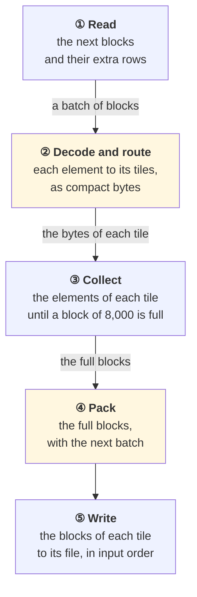

# The rules of the cut

Each output file is a complete `.osm.pbf` file. These rules give its elements (a tile, an H3 cell or an area):

1. Each node inside the boundary goes to the one tile that holds it. A node on the line between two tiles goes to
   the tile east or south of the line.
2. A way with a node in a tile goes to that tile with all its nodes, also the nodes outside the tile.
3. A relation with a member in a tile goes to that tile, with its parent relations.
4. A relation of a type in `--complete` (default: `multipolygon` and `boundary`) goes to each tile with a member,
   with all its members. Thus a program can make the polygons of a tile from the tile file alone.
5. A tile with no node inside has no file.

These are the rules of `osmium extract -s smart -S types=multipolygon,boundary`, with one difference: osmium gives a
node exactly on a tile border to the two tiles.

## H3 cells and areas

An H3 cell follows the same rules. A node goes to the cell of its point, as H3 gives it.

An area of a list follows the same rules too. The areas must not overlap:

- A node exactly on the border of an area is inside it.
- A node on a border between two areas goes to the first of the two in the list. osmium gives it to the two.
- A node inside two areas stops the cut with an error that names the two areas. pbfcut then writes no file.

## How the cut works

The cut reads the input two times, and never keeps all elements in memory:

- **Read 1** makes the plan. It records the tile of each node, the tiles of each way and relation, and the nodes
  that each tile needs from outside it. The large lists go to temporary files.
- **Read 2** writes each element into the files of its tiles, in the order of the input.

Thus the memory does not grow with the number of tiles.

### The data of the two reads

Read 1 decodes each block of the input one time. Step 3 finds the members of the relations in the id files, so it
does not read the input again.

### The threads of read 2

Blue: the calling thread. Yellow: the thread pool. The calling thread reads the next batch while the pool decodes the
batch before. Only the calling thread opens the
files: in the browser, a file belongs to the thread that opened it.

Each output file has full blocks of 8,000 elements. The elements of a tile wait in memory as compact bytes until they
fill a block. These buffers use at most one eighth of the memory budget. Above that, the largest buffers are written
before they are full, so a small budget gives other blocks, but the same elements.
